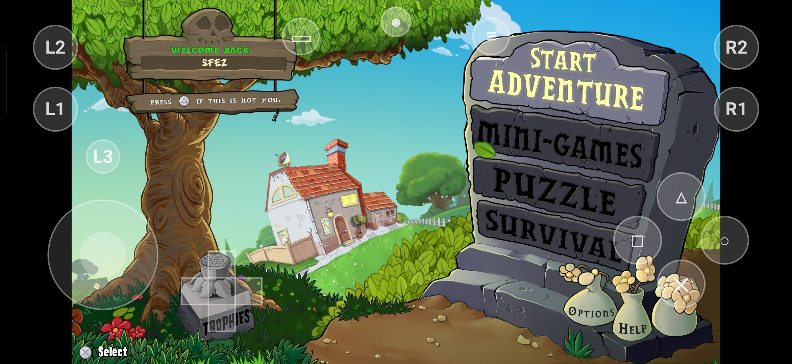
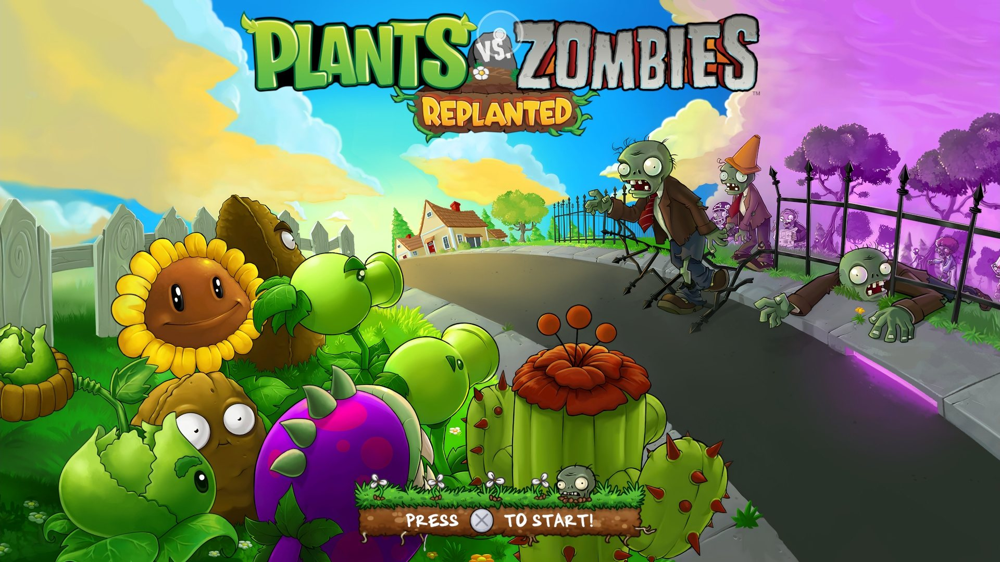
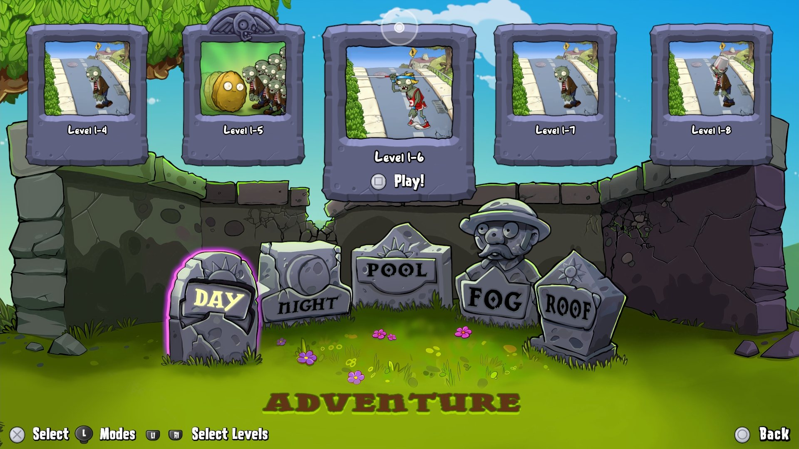
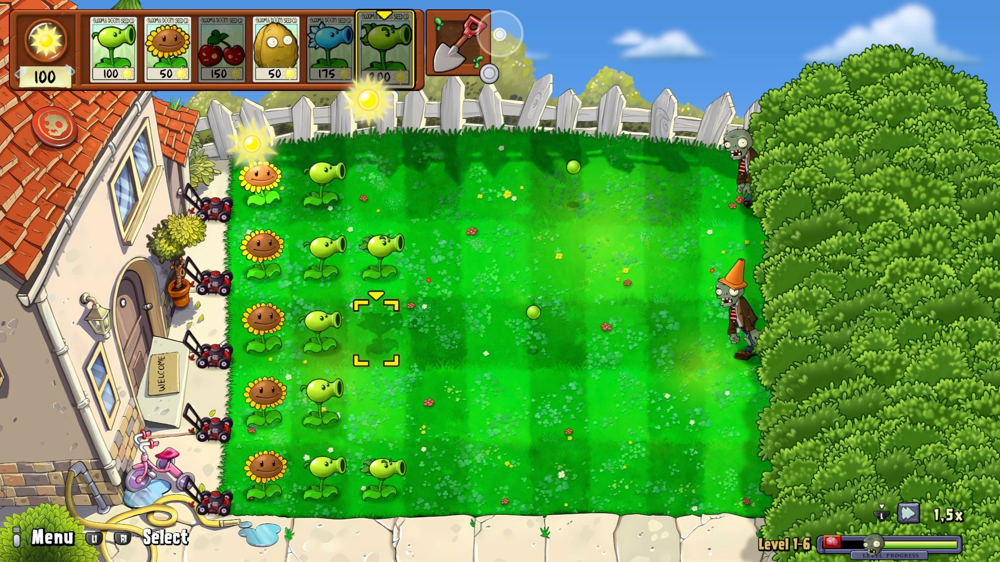

# PvZ: Replanted — Android

[English](README.md) | **Русский**

Порт PS5-версии **Plants vs. Zombies: Replanted** (PPSA29802) на Android (arm64) на основе эмулятора
[AnyPS5](https://github.com/boykopovar/AnyPS5): x86-64 код игры выполняется через встроенный
[box64](https://github.com/ptitSeb/box64), графика PS5 (AGC) переводится в Vulkan и рисуется драйвером
**Turnip** (Mesa) через [libadrenotools](https://github.com/bylaws/libadrenotools).

> ⚠️ **Игры в репозитории и в APK нет.** Нужен ваш собственный, законно полученный и **расшифрованный**
> дамп игры (папка с `eboot.bin`). Репозиторий не содержит и не распространяет файлы игры или прошивки PS5.

## Скриншоты

<table>
<tr><td colspan="3"></td></tr>
<tr><td></td><td></td><td></td></tr>
</table>
<sub>Snapdragon 8 Elite. Сверху — главное меню со встроенным сенсорным управлением (раскладка настраивается в «Настройках»).</sub>


## Требования

- Android 8.0+ (API 26), arm64-v8a.
- **Видеокарта Adreno (Snapdragon)** — встроенный Turnip работает только с Adreno (проверено на Adreno 830, Snapdragon 8 Elite).
- 8 ГБ ОЗУ и больше рекомендуется; ~5 ГБ места под игру.

## Установка и запуск

1. Установите APK (из релизов или собранный самостоятельно).
2. В лаунчере нажмите **«Папка дампа»** и выберите папку дампа игры (где лежит `eboot.bin`).
3. Нажмите **«Импорт и запуск»** — лаунчер скопирует игру в память приложения, извлечёт ELF и подготовит
   рантайм. Дальше кнопка называется **«Играть»**.

**⚙ Настройки**:
- *Графика*
  - **Драйвер GPU** — встроенный Turnip, системный драйвер Vulkan телефона или свой пакет драйвера
    (`.zip` для adrenotools с `meta.json`, как в Yuzu/Eden/Winlator). Если выбранный не загрузится, используется
    встроенный Turnip.
  - **Турбо GPU** — максимальные частоты видеокарты (быстрее, но греется сильнее).
  - **Лимит кадров 60 / 45 / 30** — против нагрева.
  - **Разрешение** — *Авто* (по умолчанию): пропорции экрана, но не выше родного кадра игры 1080p; на телефоне
    с 1440p растягивает аппаратный масштабатор дисплея, а не GPU (меньше нагрузка и нагрев). *Экран* — полное
    разрешение панели; *720p* — для слабых телефонов.
  - **Картинка на широком экране** — как кадр 16:9 ложится на экран телефона: *с полосами*, *заполнить*
    (обрезка краёв) или *растянуть*.
- *Управление*
  - **Сенсорное управление** — виртуальный геймпад поверх игры (кнопка-глаз сверху прячет его). С физическим
    геймпадом слой по умолчанию скрыт.
  - **Редактор раскладки** — перетаскивание элементов, размер одного или всех, скрыть или добавить кнопки
    (правый стик, R3), непрозрачность, сброс.
- *Язык*
  - **Язык игры** — языки, на которые переведена игра (берутся из `param.json` дампа; у PvZ: английский,
    французский, немецкий, испанский, японский, португальский (Бразилия)), или «Как в системе» — язык телефона,
    если он есть в игре, иначе английский. Русского в игре нет. Остальные языки PS5 — отдельным пунктом.
  - **Язык лаунчера** — системный, English или Русский.
- *Помощь*
  - **Логи** — zip с логом игры, logcat приложения, сведениями об устройстве и причиной последнего вылета
    (root не нужен). Приложите его к [отчёту об ошибке](https://github.com/SFEZSergey/ReplantedAndroid/issues/new/choose).

Тонкие настройки — файл `env.txt` в папке игры (`files/game/env.txt`), строки `ИМЯ=значение`
(например `APS5_FPS_LIMIT=45`, `APS5_NO_WORKER_AFFINITY=1`). Выключатели новых оптимизаций, если с ними что-то
не так: `BOX64_APS5_NATIVE=0` (без нативной замены функций libc игры), `APS5_ADPF=0` (без подсказок
производительности Android), `TU_AUTOTUNE_ALGO=bandwidth` (выбор режима проходов Turnip по умолчанию).

## Известные проблемы

- **Уровень не завершается после последнего зомби** (награда — мешок или карточка — не появляется, экран темнеет
  не до конца, растения ставить можно): если курсор стоит там, где погибает последний зомби, он подбирает награду,
  пока она ещё загружается (здесь это около секунды), и концовка уровня не доходит до конца. Отведите курсор
  в сторону до гибели последнего зомби и подберите награду, когда она появится. Если всё же случилось —
  перезапустите игру, прогресс сохраняется.

## Состав репозитория

Сам эмулятор (AnyPS5) написан на C++ и подключён подмодулем, поэтому полоса языков GitHub показывает только эту
обёртку: лаунчер APK (Java), нативную точку входа `sdl_main.c` и заголовки-прослойки bionic (C), скрипты сборки.


| Путь | Что |
|---|---|
| `android/` | APK: лаунчер и игровая Activity (Java), сенсорное управление, `native/sdl_main.c` (libmain: запуск box64, Vulkan через adrenotools, окружение), `build.sh`, `tools/` |
| `external/AnyPS5` | подмодуль (C++) — форк AnyPS5, ветка `android` (нативная bionic-группа драйвера, отслеживание записи, вывод на Android, оптимизации) |
| `external/box64` | подмодуль (C) — форк box64, ветка `android` (box64 как библиотека внутри APK, совместимость glibc поверх bionic, сигналы, DynaCache) |
| `patches/mesa-26.3-android.patch` | Turnip: импорт host-памяти через KGSL, линейные буферы swapchain с gralloc |
| `patches/sdl2-android-udev-once.patch` | SDL2 (подмодуль AnyPS5) |
| `patches/box64-android-hwcap.patch` | box64: расширения процессора (атомарные LSE, FLAGM, FRINT, CRC32…) читаются через `getauxval` bionic; без него динарек в приложении видел только ASIMD |
| `patches/anyps5-mouse-absolute.patch` | AnyPS5: функции мыши PS5 для абсолютных координат (их вызывает при старте Mewgenics, PPSA37318) |
| `patches/anyps5-volume-2darray.patch` | AnyPS5: коммит 945b970 из основного репозитория (загрузки и записи 2D-массивов в 3D-текстуры), нужен Mewgenics; только код |
| `patches/anyps5-line-on-plane.patch` | AnyPS5: одномерные загрузки и записи в 2D-текстуры и 2D-массивы (недостающие строка и слой — нули); так Mewgenics читает «линию» 9100×1 в десятках отрисовок за кадр |
| `patches/anyps5-skip-failed-shaders.patch` | AnyPS5: `APS5_SKIP_FAILED_SHADERS` (в APK включён) пропускает отрисовку с неподдерживаемым шейдером вместо закрытия игры, как в основном репозитории |
| `patches/anyps5-pass-timing.patch` | AnyPS5: при `APS5_PROFILE_GPU=1` отчёт `[gputime]` дополнительно делит время отрисовки по проходам (размер, цели, фрагментный шейдер) и один раз описывает каждый проход |
| `patches/anyps5-host-ftz.patch` | AnyPS5: float-семантика хоста в пересобранных шейдерах, по желанию: `APS5_HOST_FTZ=1` оставляет сброс денормалей f32 самому GPU, `APS5_HOST_NAN=1` — его NaN, NMin/NMax и режим без SignedZeroInfNanPreserve для f32, `APS5_HOST_DPP=1` — чтение источников DPP без ballot на каждую операцию; точная эмуляция всего этого — заметная доля шейдеров Mewgenics |
| `cmake/` | toolchain-файлы CMake (bionic arm64 и x86-64 glibc), cross-файл Meson для Mesa, `box64-emu.sh` |
| `compat/` | заголовки совместимости (ndk-shim, box64-android-compat) |

## Сборка

Собиралось на самом телефоне в **Termux** (clang/LLVM 21, cmake, ninja, meson, `aapt`, `d8`, `apksigner`,
`zipalign`, `patchelf`, OpenJDK 21). Зависимости, которые ставятся отдельно, по умолчанию ищутся в `deps/`
(все пути переопределяются переменными окружения, см. начало `android/build.sh`).

```sh
git clone --recursive https://github.com/SFEZSergey/ReplantedAndroid
cd ReplantedAndroid
git -C external/AnyPS5/3rdparty/SDL2 apply ../../../../patches/sdl2-android-udev-once.patch
git -C external/AnyPS5 apply ../../patches/anyps5-mouse-absolute.patch
git -C external/AnyPS5 apply ../../patches/anyps5-volume-2darray.patch
git -C external/AnyPS5 apply ../../patches/anyps5-line-on-plane.patch
git -C external/AnyPS5 apply ../../patches/anyps5-skip-failed-shaders.patch
git -C external/AnyPS5 apply ../../patches/anyps5-pass-timing.patch
git -C external/AnyPS5 apply ../../patches/anyps5-host-ftz.patch
```

1. **AnyPS5, нативная группа (bionic arm64)** → `external/AnyPS5/build-bionic`:
   `cmake -S external/AnyPS5 -B external/AnyPS5/build-bionic -G Ninja -DCMAKE_TOOLCHAIN_FILE=$PWD/cmake/aarch64-bionic.cmake -DCMAKE_BUILD_TYPE=Release -DAPS5_NATIVE_GROUP=ON -DAPS5_NO_FFMPEG=ON -DANYPS5_ENABLE_SPIRV_TOOLS=OFF`
   и цели `SDL2 aps5coreshim libSceAgcDriver libSceVideoOut libScePad libSceMouse libSceKeyboard libSceAudioOut`.
2. **AnyPS5, x86-64 библиотеки PS5 (PRX)** → `external/AnyPS5/build-x64s`: тот же исходник с
   `cmake/x86_64-linux-gnu.cmake`; нужен x86-64 sysroot Debian/Ubuntu (`PVZ_SYSROOT_X86_64`) и box64 для
   запуска x86-утилит сборки (`PVZ_BOX64`, см. `cmake/box64-emu.sh`).
3. **box64** (с `git -C external/box64 apply ../../patches/box64-android-hwcap.patch`) → `external/box64/build-lib`: `-DTERMUX=1 -DARM_DYNAREC=1 -DBOX64_SHARED_LIB=ON
   -DCMAKE_BUILD_TYPE=RelWithDebInfo -DCMAKE_C_FLAGS="--target=aarch64-linux-android30 -fPIC -I$PWD/compat/box64-android-compat"`.
4. **Mesa 26.3 (Turnip)**: ветка Mesa `26.3` + `patches/mesa-26.3-android.patch`, meson с
   `--cross-file cmake/mesa-android-cross.ini -Dbuildtype=release -Dvulkan-drivers=freedreno -Dgallium-drivers= -Dfreedreno-kmds=kgsl -Dplatforms=android -Dandroid-stub=true -Dandroid-libbacktrace=disabled -Dglx=disabled -Degl=disabled -Dgles1=disabled -Dgles2=disabled -Dopengl=false -Dllvm=disabled -Dzlib=enabled`
   → `MESA_BUILD_DIR`. В Termux сначала поправьте первую строку Python-скриптов на python Termux (`termux-fix-shebang`): `/usr/bin/env` там нет.
5. **libadrenotools** (сборка по его README) → `ADRENOTOOLS_DIR`; **relinker AnyPS5** для arm64
   (`-DANYPS5_RELINKER_ONLY=ON`) → `RELINKER_BIN`; x86-64 библиотеки времени выполнения из Debian/Ubuntu
   (`libstdc++.so.6/.5`, `libgcc_s.so.1`, `libssl/libcrypto 1.1 и 1.0.0`, `libmbed*`, `libpng12`, `libunwind`) → `X64LIB_DIR`;
   `android.jar` (API 35) → `ANDROID_JAR`.
6. `android/build.sh` → `android/out/PvZ-Replanted.apk` (подпись отладочным ключом, создаётся при первой сборке).

## Лицензии

Код порта — GPL-2.0 (как AnyPS5, см. `LICENSE`). Компоненты: AnyPS5 — GPL-2.0, box64 — MIT, Mesa — MIT,
SDL2 — zlib, libadrenotools — BSD-2-Clause. «Plants vs. Zombies» и связанные материалы (включая иконку
приложения) принадлежат Electronic Arts / PopCap; проект не связан с ними.
